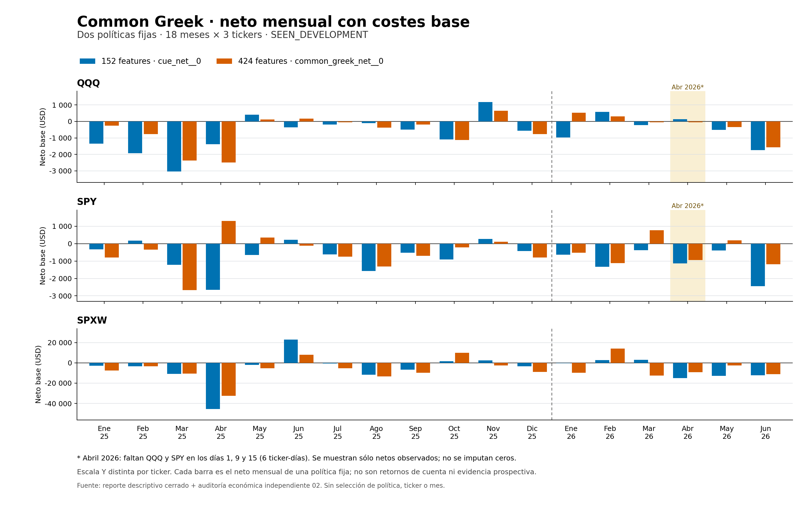

# Comparación fija 152/424: resultado negativo auditado

23 de octubre de 2026. **La ampliación a 424 variables no consigue una política
causal rentable ni el mínimo diario solicitado.** En 2026 H1 reduce las pérdidas
frente al control 152, pero los tres tickers siguen perdiendo con ambos escenarios
de costes. En 2025 empeora el agregado. No se selecciona un ganador ni se cambia
el umbral por estos resultados.

Estado científico de esta comparación: **FAILED_DEVELOPMENT_FIXED_COMPARISON**.
El productor terminó y el auditor independiente V2 emitió
`PASS_INDEPENDENT_COMMON_GREEK_COMPARISON_ECONOMIC_AUDIT`: el PASS verifica la
reconstrucción económica dados scores sellados; no significa rentabilidad.
`technical_ready=false`, `promotion_approved=false`; ambos periodos siguen
siendo **SEEN_DEVELOPMENT**, temporalmente posteriores al ajuste pero previamente
explorados. El oracle retrospectivo rentable conserva su alcance separado y no
se convierte en evidencia de un aprendiz operable.

## Comparación predefinida y costes

Se ejecutó el [plan fijo](COMMON_GREEK_DYNAMICS_V1_LEARNER_PLAN.md) y la
[especificación de comparación](COMMON_GREEK_COMPARISON_SPEC.md), escritos antes
de estos resultados. Políticas `cue_net__0` y `common_greek_net__0`, respectivamente
152 y 424 variables. El prefijo 152 es idéntico y la variante añade 272 dinámicas
de griegas calculadas sobre contratos comunes. Se reutilizaron los modelos
TRAIN ya completos; esta continuación no entrenó ni refitteó ninguno.

Los modelos comparten 270.377 filas TRAIN, IDs/orden, objetivo, pesos IPW, escalas
QQQ 88 / SPXW 680 / SPY 81 y configuración LightGBM congelada. Las diferencias de ajuste
TRAIN publicadas anteriormente no se usaron para escoger un threshold. La regla
fija escoge el mayor score estrictamente positivo, con empate por menor action_id.
WAIT avanza un minuto; NO_FILL también, sin rescatar otra acción del mismo estado.
Un fill bloquea hasta `exit_i+1`; `has_filled` sólo cambia después del fill.

Entradas y salidas mantienen el motor de zonas Fibonacci IB y put/call walls:
contrato y niveles fijados al decidir, entrada al ask del minuto siguiente,
salida al bid del mismo contrato por target, stop o cierre, sin holding fijo.
El [protocolo](PROTOCOL.md) cobra multiplicador 100, comisión 1,30 USD por lado y
slippage 0,01 por lado en base; el adverso usa 0,02. Fórmula:
`(max(bid-slip, 0)-ask-slip)*100-2.60`. Las sesiones cortas usan el reloj 210 y
las completas 390, con cierre y último estado ajustados al calendario auditado.
No se imputan fills ni se vuelven a cobrar costes ya incluidos en labels.

Son sumas de dólares netos para operaciones de un contrato. No son rendimiento
porcentual, rentabilidad compuesta, capital dimensionado ni beneficio real.
Tampoco se suman las dos políticas como cartera.

## Resultados agregados

| Periodo | Política | Fills | Neto base USD | Neto adverso USD | PF base | Días disponibles sin fill |
|---|---|---:|---:|---:|---:|---:|
| 2025 | 152 | 2569 | -76834,40 | -81963,40 | 0,829288 | 178/750 |
| 2025 | 424 | 2506 | -93912,60 | -98915,60 | 0,786669 | 190/750 |
| 2026 H1 | 152 | 1442 | -43482,20 | -46356,20 | 0,807399 | 37/363 |
| 2026 H1 | 424 | 1389 | -35329,40 | -38102,40 | 0,848169 | 47/363 |

La diferencia 424 menos 152 es **-17078,20 USD base / -16952,20 USD adverso** en 2025
y **+8152,80 USD / +8253,80 USD** en 2026 H1. Es una comparación descriptiva sobre
las mismas sesiones. La mejora relativa de 2026 mantiene pérdidas absolutas y
añade diez días disponibles sin fill; no rescata la política.

## Todos los tickers

2025 incluye 750 ticker-días, 250 por ticker, incluidas nueve sesiones cortas.
Los meses positivos de las tablas coinciden en base y adverso; el CSV conserva
ambos conteos por separado. WR es descriptivo: no se introduce ningún gate de WR.

| 2025 | Política | Fills | Base USD | Adverso USD | PF base | WR base | Sin fill | Meses positivos |
|---|---|---:|---:|---:|---:|---:|---:|---:|
| QQQ | 152 | 613 | -8913,80 | -10138,80 | 0,688503 | 30,67% | 88/250 | 2/12 |
| QQQ | 424 | 640 | -7464,00 | -8739,00 | 0,725788 | 32,34% | 93/250 | 3/12 |
| SPXW | 152 | 1299 | -59715,40 | -62308,40 | 0,849655 | 29,41% | 7/250 | 3/12 |
| SPXW | 424 | 1291 | -80515,60 | -83094,60 | 0,794554 | 27,11% | 9/250 | 2/12 |
| SPY | 152 | 657 | -8205,20 | -9516,20 | 0,662029 | 31,05% | 83/250 | 3/12 |
| SPY | 424 | 575 | -5933,00 | -7082,00 | 0,718751 | 30,09% | 88/250 | 3/12 |

2026 H1 conserva 369 ticker-días esperados. SPXW dispone de 123; QQQ y SPY de 120
cada uno. Faltan exactamente QQQ/SPY en 20260401, 20260409 y 20260415: seis casos
**NO_EVALUABLE**, separados de los días observables sin fill y de las pérdidas.

| 2026 H1 | Política | Fills | Base USD | Adverso USD | PF base | WR base | Sin fill disponible | Meses positivos |
|---|---|---:|---:|---:|---:|---:|---:|---:|
| QQQ | 152 | 327 | -2737,20 | -3390,20 | 0,822550 | 33,64% | 22/120 | 2/6 |
| QQQ | 424 | 320 | -1185,00 | -1825,00 | 0,914634 | 34,69% | 25/120 | 2/6 |
| SPXW | 152 | 601 | -34448,60 | -35644,60 | 0,821771 | 24,63% | 2/123 | 2/6 |
| SPXW | 424 | 667 | -31365,20 | -32696,20 | 0,847840 | 25,64% | 1/123 | 1/6 |
| SPY | 152 | 514 | -6296,40 | -7321,40 | 0,630822 | 32,49% | 13/120 | 0/6 |
| SPY | 424 | 402 | -2779,20 | -3581,20 | 0,780710 | 31,34% | 21/120 | 2/6 |

## Meses, cobertura y gates originales

Se publican los [108 grupos mensuales](COMMON_GREEK_COMPARISON_MONTHLY_20261023.csv):
ambas políticas, tres tickers y los 18 meses completos de 2025–2026 H1. Incluyen
neto/PF/WR base y adverso, flags de PF infinito, cobertura, días sin fill y
fechas ausentes. Un PF indefinido queda vacío en CSV, acompañado por su flag;
no se sustituye por cero o infinito sin distinguirlos. Los
[16 agregados anuales/de periodo](COMMON_GREEK_COMPARISON_ANNUAL_20261023.csv)
incluyen los tres tickers y ALL para ambas políticas/periodos. El agregadoALL
describe contabilidad y no sustituye los gates por ticker.

La [figura SVG](continuation_20261023/figures/COMMON_GREEK_RESULT_20261023_monthly_net_base.svg)
muestra todas las 108 barras, con escalas monetarias separadas por ticker y las
ausencias de abril 2026 anotadas. No se eligieron sólo meses o trades favorables.

El gate económico original del [PROTOCOL](PROTOCOL.md), reiterado en
[LEARNER_PLAN](LEARNER_PLAN.md), exige simultáneamente en los tres tickers de
2026 H1: neto base > 0, neto adverso > 0, PF base ≥ 1,20, al menos 60 fills y al menos
tres meses positivos de seis. Se añade el requisito posterior de al menos un
fill por ticker-día disponible, conservando la cobertura universal separada.
La comparación fija transporta esas reglas; no cambia umbrales ni elige ganador.

**Ambas políticas fallan** base, adverso, PF y meses positivos en cada ticker.
Sólo pasan el mínimo total de 60 fills por ticker. También fallan el mínimo diario
en los tres tickers. La cobertura universal de QQQ/SPY es NO_EVALUABLE por las
fuentes ausentes; SPXW tiene calendario completo pero días sin fill. No se puede
atribuir la conclusión negativa exclusivamente a los seis casos ausentes:
la economía y frecuencia de las sesiones disponibles también incumplen.

Los gates numéricos de 2026 H1 se marcan `NOT_APPLICABLE` en las filas CSV de 2025
y ALL; esas filas siguen informando todas sus métricas y frecuencia. No se
presenta el mismo umbral de 60 como regla anual nueva ni se añade un umbral de WR.

## Auditoría, fallos preservados y ejecución

Productor: exit 0, 4715,295044 s, sin refit. Sus predicciones se sellaron antes de
labels de cada día; el freeze de 2026 liga el cierre 2025 sin elegir ganador.
El control 152 fue reproducido exactamente frente a la comparación compacta
ya auditada en 1113 sesiones disponibles, incluidas las nueve cortas.

El [auditor 01 falló técnicamente](COMMON_GREEK_AUDIT_01_TECHNICAL_FAILURE_20261023.md)
por una consulta de claves POSIX sobre un manifest Windows. Sus recibos y el
auditor original permanecen intactos. V2 corrigió sólo identidad/seguridad de
rutas, con pruebas y revisión independiente antes de publicarse y ejecutarse.
La auditoría posterior 02 terminó **exit 0**, 649,399598 s, con
`PASS_INDEPENDENT_COMMON_GREEK_COMPARISON_ECONOMIC_AUDIT`.

Reconstruyó ambos schedulers, intentos/fills, costes, calibración descriptiva y
cobertura de 750 + 369 ticker-días; comprobó los 1113 controles bitexactos, nueve cortas,
seis ausentes, freezes, contratos, fuentesTRAIN y rehash final. Su alcance es
**ECONOMIC_EXECUTION_GIVEN_SEALED_PREDICTIONS**: no refittea modelos, no reproduce
la inferencia ni afirma recepción histórica observada, reconstrucción completa
de raw quotes o paridad live.

El reporte mensual terminó exit 0 con 108 grupos y sin predicciones nuevas. Emitió
advertencias `FutureWarning` de Pandas sobre concatenación futura de entradas
vacías; se preservan en stderr. Los checks actuales de identidad, calendario,
conteos y contabilidad pasaron. El reporter congelado no se modificó después
de ejecutarse para silenciar esas advertencias.

Recursos del productor: pico RSS 296.677.376 B, mínimo libre observado
RAM 2.315.599.872 B y commit 91.951.104 B. El gate es de admisión, no una reserva
permanente: se conserva ese mínimo de commit sin atribuirle una causa o pérdida
de datos. Auditor 02: 649 muestras, pico RSS 200.310.784 B, pico privado 168.714.240 B,
mínimos RAM 4.323.557.376 B / commit 2.140.606.464 B, sin errores de monitor. Estos son
extremos observados a 1 s, no cotas de picos instantáneos. Ambos exit codes proceden
de los handles de sus procesos, no de archivos de progreso residuales.

La [verificación independiente del informe](COMMON_GREEK_MONTHLY_REPORT_VERIFICATION_20261023.md)
reconstruyó los 108 grupos mensuales y 16 anuales desde las 2238 fuentes de
intentos, sin importar el reporter, y rehasheó 3365 archivos sin diferencias.
Los [CSV y gates](COMMON_GREEK_MONTHLY_CSV_VERIFICATION_20261023.json) y el
[contenido completo del archivo consolidado](COMMON_GREEK_ARCHIVE_CONTENT_VERIFICATION_20261023.json)
también se contrastaron independientemente. Los floats de los intentos
consolidados coinciden bit por bit con las fuentes y se conservaron las filas
diarias de ambas políticas, incluidos los casos ausentes. Estas comprobaciones
validan representación y contabilidad; no cambian el resultado económico.

## Artefactos completos y reproducción

La raíz local sigue siendo `D:/GexResearchArtifacts/level_oracle_20261018`.
Se archivaron 38 artefactos compactos exactos, 16.511.029 bytes en total; el mayor
mide 2.911.339 bytes. Ambos modelos son pequeños y se incluyen después de comprobar
sus tamaños: modelo de 424 variables, 724.511 B; modelo de 152 variables,
716.463 B. Ningún archivo copiado supera 100 MB.

El [manifest del archivo](continuation_20261023/common_greek_result/manifest.json)
lista rutas originales, tamaños y hashes; liga 3395 fuentes consumidas rehasheadas
al cierre. Las matrices TRAIN, caches de mercado y scores grandes por acción
permanecen locales, referenciados por los manifests copiados. No se cambió Git LFS
ni se subieron datos brutos.

Se conserva además el contenido completo de todos los
[7908 intentos](continuation_20261023/common_greek_result/all_attempts.parquet):
7906 FILLED y 2 NO_FILL entre ambas políticas y periodos, con IDs, estados, score,
`has_filled_before`, salida y ambos netos. La concatenación tiene readback exacto.
No se eliminan intentos perdedores. La
[tabla diaria completa](continuation_20261023/common_greek_result/daily_coverage_and_economics.csv)
incluye 2238 filas, dos políticas por 1119 ticker-días. Conserva los campos del
productor y añade `observed_net_base/adverse` nulos para MISSING_SOURCE: los ceros
de representación de los summaries originales no se reinterpretan como retorno
observado. Las calibraciones completas permanecen en los reports archivados y
sus summaries diarios locales ligados al seal.

El [packager](continuation_20261023/package_common_greek_result.py) crea solamente
copias/tablas descriptivas: no modelo, predicción, selección o evaluación nueva.
Rechaza salidas existentes y verifica fuentes/modelos contra los bindings
auditados. No debe reejecutarse sobre su raíz ya cerrada. El reporter publicado
es `report_common_greek_comparison_monthly.py`, SHA
`56be763eae74ae043c5a90b2d22f75b552ae34942af56e462d82297aac5a512f`.

| Evidencia | SHA256 |
|---|---|
| Productor `completion.json` | `40cfdf576885eecd10785946687e5cf87cce228c1483e3ddd43cbd911207c824` |
| Productor `comparison.complete.json` | `ad916c5695e165693c9843d206329732dde1d9149fc8ee0f9354818caf399d6d` |
| Auditor 02 `audit.json` | `45caae6c11cdce9306284367e7742d9dbe17e03a8afeb52eff447b3408758a0d` |
| Código auditor V2 | `2d4fc43456c4cd6fe45b378fae3580481a98e814c2eefa42b8eb1dec63f049d3` |
| Summary mensual | `6086af9fba7d5a7423a36eda120c9873415a9c3f3f5b61d9fea0bfa3ab47183c` |
| CSV 108 mensuales | `02db7542e228cd07e9ca206663524562b53067c5171b323a78da83fb4b9af7ef` |
| CSV 16 anuales/periodos | `a83163ffb5f80a10087543146d8fef11cb59affcac5a43d1cce67553012a05d4` |
| Intentos completos | `6cdfec84d2f0ff30355e5bc5526268d90d84aedb49d94eba06318db122ae23ed` |
| Cobertura/contabilidad diaria | `45e084c8442b2a1aba410b8005ab24863de5bb2e8d2ff903e43779e5444e396d` |
| Manifest del archivo | `3794ebdb668f8cacdd6410bc9a22b032531ee63f262559e035f0fddd2411c92d` |
| Modelo 424 | `10b1c409a575797a2827e64a272809006917c17342f41c09fedd2d737a54e82c` |
| Modelo 152 | `a457176f12df8ab44964f1b595c75439320c8ee27db9da7a740b95f29fa016c7` |

El resultado no autoriza promoción, órdenes ni cambios de producción. La
investigación de otras hipótesis continúa separada: esta comparación conserva
su diseño fijo, ambos resultados negativos y los límites de su auditoría.
