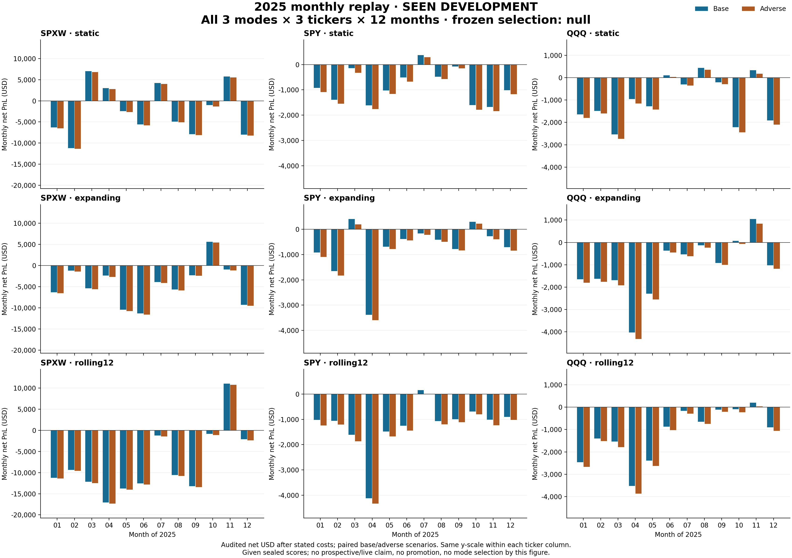

# Consolidación auditada de 2025 — 2026-10-24

El reporter terminó una vez con **exit 0 y manifest COMPLETE**, desde la
publicación `02cb4f7404abab0564c567d17eeaccd887b22a24`, tras verificar el cierre
real de la auditoría. Se reconcilian los doce meses de 2025, los tres tickers y
los tres modos fijos: `static`, `expanding` y `rolling12`. No se reentrenó,
repitió inferencia, recalculó selección ni consumió economía de 2026 para esta
consolidación; el índice sellado sí aporta metadatos del calendario completo.

La selección ya congelada sigue siendo **null**. En los agregados descriptivos
de los tres tickers, static registra −49.152,40 USD base / −55.127,40 adverso;
expanding −75.243,80 / −81.319,80; rolling12 −122.081,40 / −129.124,40.
Los días disponibles sin fill son 72, 99 y 45 de 750, respectivamente.
No se elige un ganador ni se modifica ninguna regla por estos resultados.
2025 es el periodo de selección/desarrollo visto, no evidencia prospectiva.

Las tablas completas están en [monthly.csv](continuation_20261024/monthly_validation_2025_report/outputs/monthly.csv)
y [periods.csv](continuation_20261024/monthly_validation_2025_report/outputs/periods.csv):
108 filas ticker-mes más 36 `ALL`, y nueve filas ticker-periodo más tres `ALL`.
Los agregados `ALL` son descriptivos y no sustituyen las cifras por ticker.
[daily.csv](continuation_20261024/monthly_validation_2025_report/outputs/daily.csv)
conserva los 2.250 registros modo/ticker-día: 750 sesiones-ticker disponibles
por modo, sin fuentes ausentes en 2025. Hay 9.569 intentos y 9.566 FILLED
consolidados **entre las tres políticas**, no un único portfolio operativo.
Se conservan las tres tentativas NO_FILL y todas las columnas de ambos ledgers.

El [summary](continuation_20261024/monthly_validation_2025_report/outputs/summary.json)
requiere el [manifest COMPLETE](continuation_20261024/monthly_validation_2025_report/outputs/output_manifest.json),
SHA `66108b5eb4e678569dcc82a46ebaa92f569a3601e160a2ab1ac781725313db0f`.
Auditoría de entrada:
`ba9fbd9edf849eb823f098461906feede9782b1e513f4d1954e6d58f52549cbc`;
reporter `1968aefcba4abf650d5e13cd16435ac74067cfee78ce5752fde6427e5a941146`.
Se cotejaron diarios, economía mensual y reportes anuales con los ledgers
sellados. El reporter rehasheó 6.806 fuentes consumidas antes y después; el
inventario completo referencia 38.107 archivos. Esto no repite la auditoría de
modelos/features, raw, scheduler o scores: hereda su alcance «given sealed
scores». El rehash posterior de los siete outputs también pasó.

El [recibo de exit](continuation_20261024/monthly_validation_2025_report/logs/exit.json)
liga PID 20216 y creation time 1792800335.8044086 al handle retenido de Popen.
Duración 109,073846 s, 109 muestras de recursos, pico RSS muestreado
303.075.328 B; monitor sin error y stderr vacío. Gate Windows previo:
RAM 7.583.686.656 B / commit libre 5.485.998.080 B. Los mínimos muestreados
fueron 7.108.694.016 / 4.880.678.912 B. Código y auditoría conservaron sus SHA.

El [archivo compacto](continuation_20261024/monthly_validation_2025_report/manifest.json)
contiene 14 copias exactas, 10.152.599 B, incluidas tablas, ledgers, inventario y
logs. SHA de su manifest:
`e60c45397346440506ac70daa8ad9cd55d4160643d962c0f18abb582911785b5`.
El inventario de 8,65 MB se incluye completo; matrices, features, modelos y raw
permanecen locales con sus referencias. Ningún archivo antiguo se sustituyó.

Root local del resultado:
`D:/GexResearchArtifacts/level_oracle_20261018/monthly_validation_2025_consolidated_report_20261024_01`.
Los costes base/adverso, PF indefinido con flag separado, WR y drawdown mantienen
el contrato auditado. No hay autorización de promoción ni evidencia live.

La [reconciliación independiente](MONTHLY_VALIDATION_2025_INDEPENDENT_FIGURE_RESULT_20261024.md)
terminó PASS: cotejó los 156 grupos mensuales/de periodo y las 2.250 filas
diarias contra los ledgers consolidados, incluidas todas las métricas. Los nueve
agregados anuales modo/ticker son negativos en ambos escenarios de costes.
La gráfica incluye los doce meses y las nueve combinaciones; comparte escala
vertical entre modos dentro de cada ticker. Se inspeccionó el PNG y mantiene
visibles el alcance de desarrollo y la selección null.

[Gráfica vectorial SVG](continuation_20261024/monthly_validation_2025_independent_figure/monthly_net_usd_all_modes_2025.svg).
