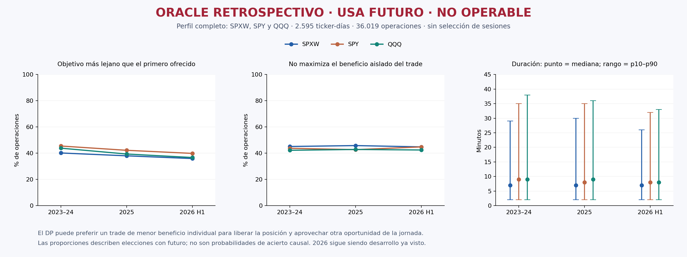
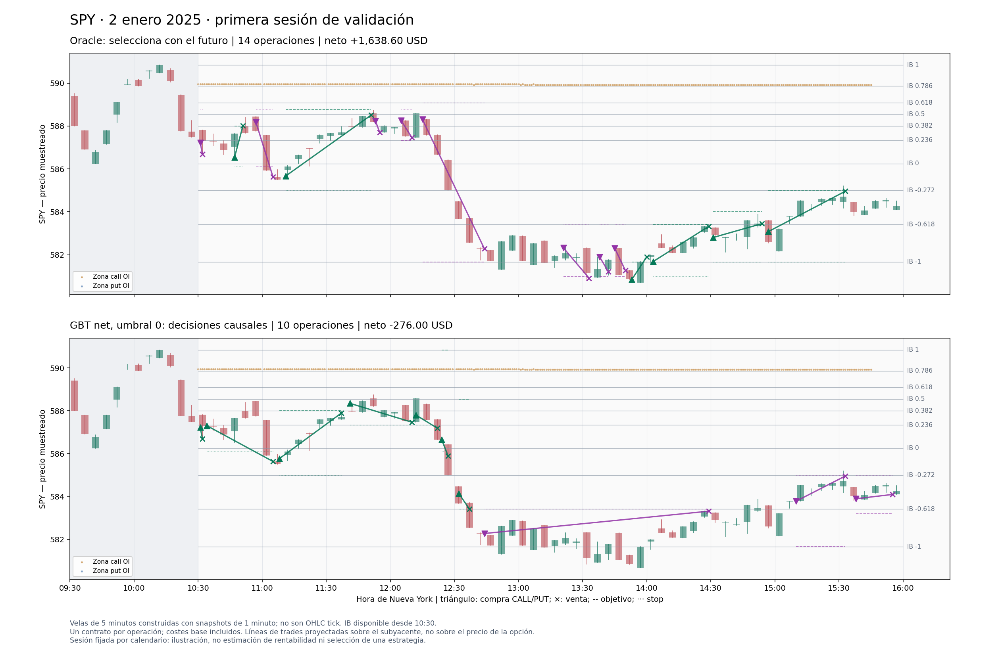
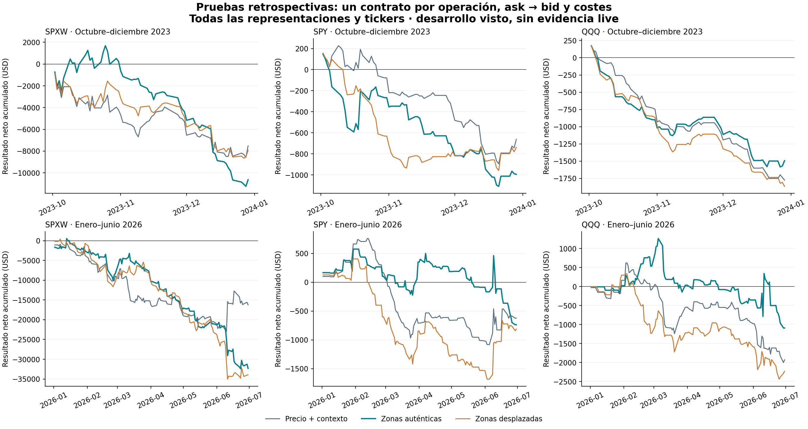

# Gráficas existentes archivadas

Copias exactas de figuras ya generadas durante la investigación. No se han vuelto a calcular datos ni dibujado curvas nuevas después de parar. Las imágenes del oracle usan futuro y son retrospectivas; las gráficas causales ilustran un corte temporal, no una estrategia rentable.

Las variantes iniciales y finales se conservan en sus subdirectorios. La versión final de cada sesión oracle está bajo `oracle_charts/final`. El gráfico agregado compara políticas distintas, no una cartera conjunta.

| Figura | Bytes | SHA256 |
|---|---:|---|
| [figures/level_oracle_20261018/fixed_session_comparison_v1/comparison.png](figures/level_oracle_20261018/fixed_session_comparison_v1/comparison.png) | 251475 | `52ada242c5af51580773fd1fe8ae15bcf131150d09aab03ffbbc757db01f1685` |
| [figures/level_oracle_20261018/oracle_behavior_v2/oracle_behavior_profile.png](figures/level_oracle_20261018/oracle_behavior_v2/oracle_behavior_profile.png) | 144768 | `01820e246cb6dd2a6f9ac11bd52a8dfbdc30399332a709636df43fb98e5f1b9d` |
| [figures/level_oracle_20261018/oracle_charts/final/QQQ_20230103_oracle.png](figures/level_oracle_20261018/oracle_charts/final/QQQ_20230103_oracle.png) | 366167 | `4a89d79d9244d0c2bae7bd7523758744dba4c53f3f16f9ed2417dbea7aea4543` |
| [figures/level_oracle_20261018/oracle_charts/final/SPXW_20230103_oracle.png](figures/level_oracle_20261018/oracle_charts/final/SPXW_20230103_oracle.png) | 357951 | `19f4e80420f509cdb3f2629e9e93339a167b033e64239c8f9277dc3efd582d94` |
| [figures/level_oracle_20261018/oracle_charts/final/SPY_20230103_oracle.png](figures/level_oracle_20261018/oracle_charts/final/SPY_20230103_oracle.png) | 420579 | `b4f867be7d17c58128965134c44a6573c6aa14d6a40dcee4991d41347fd66a80` |
| [figures/level_oracle_20261018/oracle_charts/QQQ_20230103_oracle.png](figures/level_oracle_20261018/oracle_charts/QQQ_20230103_oracle.png) | 366195 | `75fed403c61a96bcd3e2dff8a49d32757557c4d21b01dd924d0c0382b57b2811` |
| [figures/level_oracle_20261018/oracle_charts/SPXW_20230103_oracle.png](figures/level_oracle_20261018/oracle_charts/SPXW_20230103_oracle.png) | 357991 | `c468a2a7537d953a215bab1ae6f1846d605a814bbbc75e5b97d4272082b944f6` |
| [figures/level_oracle_20261018/oracle_charts/SPY_20230103_oracle.png](figures/level_oracle_20261018/oracle_charts/SPY_20230103_oracle.png) | 418716 | `7652382d50cd12fb8ba873046fae1f5767824608c694ada00c4e2bf434d5ce64` |
| [figures/restart_20261018/benchmark_comparison.png](figures/restart_20261018/benchmark_comparison.png) | 469635 | `5f51b4c35c48ce92feaaa8b8a3f136bca477bbf5aa1e0791191607a37c680046` |
| [figures/restart_20261018/causal_charts/QQQ_20230103_causal_1235.png](figures/restart_20261018/causal_charts/QQQ_20230103_causal_1235.png) | 173914 | `23968f4fd88133fba6403c2028e1a519594c22e15ae5fec47d891ef26a387284` |
| [figures/restart_20261018/causal_charts/QQQ_20260102_causal_1235.png](figures/restart_20261018/causal_charts/QQQ_20260102_causal_1235.png) | 179970 | `4e430548f7a10f80fae564413524e2c53322af100791e118b5d1a489c9fe279f` |
| [figures/restart_20261018/causal_charts/SPXW_20230103_causal_1235.png](figures/restart_20261018/causal_charts/SPXW_20230103_causal_1235.png) | 179691 | `284d29545ded272e70bd2ad36c6792b08cba38df31a28b9d85ab46f6ccdc842e` |
| [figures/restart_20261018/causal_charts/SPXW_20260102_causal_1235.png](figures/restart_20261018/causal_charts/SPXW_20260102_causal_1235.png) | 177156 | `8553beef59100aa7346131d597a3f2bd3bbdf1ffcd278b03fbf855df4c6498c7` |
| [figures/restart_20261018/causal_charts/SPY_20230103_causal_1235.png](figures/restart_20261018/causal_charts/SPY_20230103_causal_1235.png) | 173432 | `315475c08dca0180243f9f25de5b026eb19edfd5c02c0eb7c930536a753ffb37` |
| [figures/restart_20261018/causal_charts/SPY_20260102_causal_1235.png](figures/restart_20261018/causal_charts/SPY_20260102_causal_1235.png) | 176482 | `70bca7030775bdfac00e8c4174c6dc2c86b931d306746587d8cd2e45baca36b0` |

## Perfiles del oracle

## Comparación de sesión fijada

## Benchmarks iniciales

