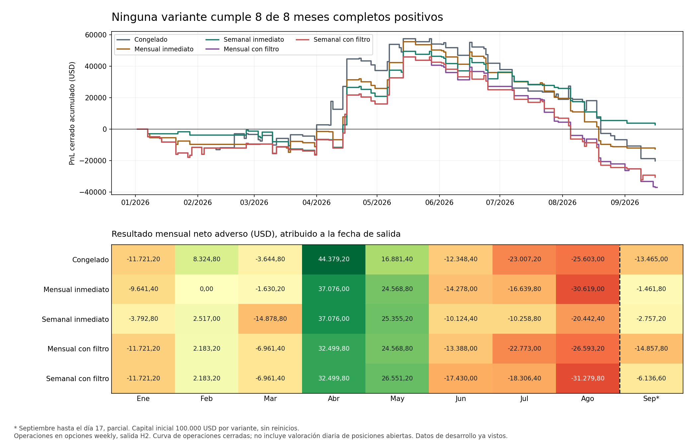

# Reentrenamiento mensual y semanal: resultado cerrado

**Ninguna de las cinco políticas cumple ocho meses completos positivos.** El reentrenamiento semanal inmediato acaba con +2.693,80 USD adversos, pero sólo gana en tres de ocho meses completos; su drawdown realizado es 46.860,80 USD. El beneficio agregado no satisface el criterio del usuario. No se selecciona ningún modelo.

Periodo: 2 de enero a 17 de septiembre de 2026; septiembre es parcial. Opciones weekly de SPY/QQQ/SPXW, entrada 10:35 y salida después de dos sesiones (H2). Capital inicial 100.000 USD una sola vez por política. Los meses atribuyen el neto completo de cada operación a su salida; no representan valoración diaria a mercado.

| Política | Neto base USD | Neto adverso USD | Meses positivos ene–ago | PF adverso | DD realizado USD | Trades |
|---|---:|---:|---:|---:|---:|---:|
| Congelado | -18.747,20 | -20.204,20 | 3/8 | 0.8874 | 77.701,60 | 124 |
| Mensual inmediato | -11.559,40 | -12.625,40 | 2/8 | 0.8964 | 68.767,90 | 89 |
| Semanal inmediato | 3.645,80 | 2.693,80 | 3/8 | 1.0259 | 46.860,80 | 83 |
| Mensual con filtro | -35.875,80 | -37.042,80 | 3/8 | 0.7540 | 82.935,10 | 100 |
| Semanal con filtro | -29.419,20 | -30.601,20 | 3/8 | 0.7879 | 78.093,30 | 100 |

## Todos los meses, sin exclusiones

| Mes | Congelado | Mensual inmediato | Semanal inmediato | Mensual con filtro | Semanal con filtro |
|---|---:|---:|---:|---:|---:|
| 2026-01 | -11.721,20 | -9.641,40 | -3.792,80 | -11.721,20 | -11.721,20 |
| 2026-02 | 8.324,80 | 0,00 | 2.517,00 | 2.183,20 | 2.183,20 |
| 2026-03 | -3.644,80 | -1.630,20 | -14.878,80 | -6.961,40 | -6.961,40 |
| 2026-04 | 44.379,20 | 37.076,00 | 37.076,00 | 32.499,80 | 32.499,80 |
| 2026-05 | 16.881,40 | 24.568,80 | 25.355,20 | 24.568,80 | 26.551,20 |
| 2026-06 | -12.348,40 | -14.278,00 | -10.124,40 | -13.388,00 | -17.430,00 |
| 2026-07 | -23.007,20 | -16.639,80 | -10.258,80 | -22.773,00 | -18.306,40 |
| 2026-08 | -25.603,00 | -30.619,00 | -20.442,40 | -26.593,20 | -31.279,80 |
| 2026-09 (parcial) | -13.465,00 | -1.461,80 | -2.757,20 | -14.857,80 | -6.136,60 |

Febrero mensual inmediato es cero y cuenta como mes no rentable. Se permiten días sin operar, pero no se eliminan meses sin beneficio del denominador.

## Qué mejoró y qué no

La actualización semanal inmediata reduce la pérdida de julio–septiembre parcial a −33.458,40 USD, frente a −62.075,20 USD del congelado en este libro continuo. Sigue perdiendo en los tres meses. Sin abril, su neto total sería −34.382,20 USD; al restar únicamente su mayor operación ganadora (+12.232,80 USD), sería −9.539,00 USD. Son restas descriptivas, no estrategias alternativas.

El Q3 congelado anterior de −58.128,60 USD era un experimento separado. El libro continuo añade una operación del puente de junio cerrada en julio, por −3.946,60 USD: −62.075,20 USD. No se suman dos cuentas reiniciadas para construir este resultado.

## Filtro de actualizaciones y regresión

Cada propuesta se compara con una copia del modelo vigente durante 21 sesiones posteriores. Sólo se admite si no empeora logloss ni neto adverso. Aprobación retrospectiva con datos ya maduros no asegura mejoras después de activarla. Las propuestas contra una versión ya sustituida se rechazan como obsoletas.

| Frecuencia | Aprobadas | Rechazadas por comparación | Obsoletas | Pendientes | Último modelo activo | Sesiones desde aceptación |
|---|---:|---:|---:|---:|---|---:|
| MONTHLY | 3 | 2 | 3 | 1 | CONTEXT182_20260501 | 72 |
| WEEKLY | 5 | 9 | 19 | 5 | CONTEXT182_20260727 | 14 |

El filtro mensual termina 24.417,40 USD por debajo de actualizar inmediatamente; el semanal, 33.295,00 USD por debajo. No evitó la regresión económica. El modelo mensual aceptado el 4 de junio permaneció activo hasta el corte y sus entradas posteriores acumularon −73.076,20 USD. Son resultados del modelo activo, no un efecto causal aislado de la frecuencia o del retraso.

| Frecuencia | Activación | Modelo | Sesiones activas | Trades de esa cohorte | Neto posterior USD |
|---|---|---|---:|---:|---:|
| MONTHLY | 20260205 | CONTEXT182_20260102 | 39 | 14 | 5.239,00 |
| MONTHLY | 20260402 | CONTEXT182_20260302 | 43 | 26 | 42.849,40 |
| MONTHLY | 20260604 | CONTEXT182_20260501 | 73 | 46 | -73.076,20 |
| WEEKLY | 20260205 | CONTEXT182_20260102 | 39 | 14 | 5.239,00 |
| WEEKLY | 20260402 | CONTEXT182_20260302 | 24 | 16 | 39.361,40 |
| WEEKLY | 20260507 | CONTEXT182_20260406 | 53 | 29 | -19.525,60 |
| WEEKLY | 20260724 | CONTEXT182_20260622 | 24 | 18 | -37.484,40 |
| WEEKLY | 20260827 | CONTEXT182_20260727 | 15 | 9 | -6.136,60 |

## Probabilidades y valor esperado

Las 612 oportunidades evaluadas son comunes a las cinco políticas. Los seleccionados incluyen intentos rechazados por ejecución/riesgo, además de fills. El sesgo EV es predicción menos neto observado por contrato: positivo significa sobreestimación media. Logloss/Brier menores son mejores.

| Política | Logloss todas | Brier todas | Sesgo EV seleccionadas USD/contrato | MAE EV seleccionadas USD/contrato | N seleccionadas |
|---|---:|---:|---:|---:|---:|
| Congelado | 1.237447 | 0.651829 | 217,29 | 971,66 | 153 |
| Mensual inmediato | 1.269657 | 0.661949 | 169,30 | 1.002,26 | 110 |
| Semanal inmediato | 1.263848 | 0.660280 | 148,59 | 1.024,58 | 105 |
| Mensual con filtro | 1.268471 | 0.662269 | 106,21 | 976,71 | 122 |
| Semanal con filtro | 1.279547 | 0.667082 | 205,46 | 987,97 | 123 |

Las actualizaciones no mejoran logloss/Brier agregados frente al congelado en este periodo. El semanal inmediato mantiene sobreestimación media de EV seleccionada de +148,59 USD/contrato y MAE 1.024,58 USD/contrato. El calendario de reentrenamiento por sí solo no resuelve la selección de oportunidades con EV realizable. El archivo JSON conserva métricas con y sin cotas por datos ausentes; no se excluyen esas cotas del resultado principal.

## Método, alcance y límites

- 42 fits independientes de regresión logística multiclase CONTEXT182, 9 fechas mensuales y 38 semanales con 5 coincidencias. Imputación y escalado sólo con TRAIN; calibración con 63 sesiones anteriores maduras; TRAIN expansivo desde 2023. No se modificaron arquitectura, umbrales, features ni reglas tras ver resultados.
- Cada ajuste empieza de cero conservando el histórico de TRAIN. No hay entrenamiento neuronal incremental que sobrescriba pesos de tareas anteriores. Esto evita ese mecanismo concreto de olvido, pero no demuestra que preservar historia o el filtro impidan regresión futura. Las 63 sesiones de calibración quedan fuera del ajuste de coeficientes.
- Riesgo máximo 5.000 USD por entrada, un máximo de una posición por ticker y tres simultáneas. Comisión 1,30 USD por contrato/lado; deslizamiento 0,01 base y 0,02 adverso. Se supone fill completo al quote guardado, sin simulación de profundidad/volumen ni fills parciales.
- El DD es realizado, no mark-to-market; no acredita el riesgo intratrade ni una curva de valoración diaria. El ajuste disponible antes de 10:30 es un supuesto operativo no verificado en vivo.
- Todos los periodos son SEEN_DEVELOPMENT. Ningún resultado constituye un holdout nuevo ni garantiza meses futuros positivos. technical_ready=false, promotion_approved=false, selección null.

## Integridad y aclaración del reloj

Productor d03494bf completó 42 fits una sola vez, exit0 a18:14:13.873980UTC. Auditores01/02/03 fallidos se conservan: campo EV de replay, evento inicial sin caja y divergencia de interpretación del reloj, respectivamente. Ninguno se presenta como PASS parcial.

El reloj conservador gate_end+3 ya estaba publicado en código/tests antes del run. La aclaración textual se decidió después del run: el auditor anterior exigía la primera fecha posible según etiquetas efectivas, requisito no explícito en el contrato. La regla conservada retrasa nueve resoluciones una o dos sesiones. No se ejecutó ni se eligió una variante más temprana para mejorar PnL. Durante el diagnóstico se imprimió incidentalmente la comparación de la primera propuesta; el resumen agregado no se interpretó hasta el cierre auditado. [Aclaración y revisión](ADAPTATION_CLOCK_CLARIFICATION_AND_AUDIT_V4_SCOPE_20261101.md).

Auditor04 0723696a terminó exit0 el1nov2026 a18:54:51.566895UTC. Reconstruyó 42 estados, 3.060 scores (612×5), 10 libros, 47 propuestas y 890 filas de calendario. PASS_INDEPENDENT_NUMERIC_RECONSTRUCTION_GIVEN_SAVED_WEIGHTS_NOT_REFIT: reconstrucción con coeficientes guardados, sin refit independiente ni nueva lectura raw. Revisión independiente comprobó21inputs,18outputs,19pins y4recibos de archivos del cierre.

Audit SHA9a487fba18504ae4faff2c1dba17d1c000eb237436a09a7fe22747e328cb307a; exit5d59d1a3978d8d9aa31c7c3fab567d1ae7e901494aa8efb12377ca65f91de420. Sin acceso API/bróker ni cambios productivos.

La comparación queda cerrada con fallo del criterio mensual. La siguiente hipótesis debe centrarse en la calibración y ordenación del EV de oportunidades seleccionadas, incluyendo abstención y evaluación temporal predefinida; estos resultados no justifican otra búsqueda de frecuencia ni rescatar tickers/meses. No se ha entrenado ni autorizado para producción una variante nueva.
