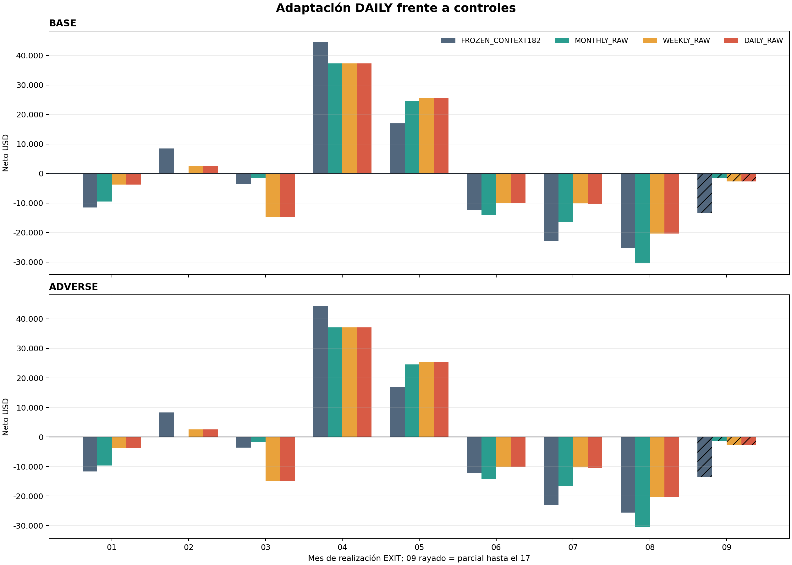

# Resultado descriptivo de adaptación diaria

Este informe describe artefactos reconstruidos por auditoría independiente. No reentrena, no infiere, no repite libros y no selecciona una frecuencia ganadora. Todo 2026 permanece **SEEN_DEVELOPMENT**; `technical_ready=false` y `promotion_approved=false`.

## Autoridad

- Manifest productor: `7decb3e2baf360d807fd849604013728f5fe05c48dcd3302c0b270a1440d2206`.
- Auditoría independiente: `383edce65b16b316dcf71f2197a716d71501495f704040e858cea9354511b2b9`.
- Exit auditor: `6c9e236906de004c9da015021424e690b1dc8d1ed06514533fdcbfc4c3a524e8` (`exit_code=0`).

## Estados y agenda

Agenda: 178 sesiones; 42 estados reutilizados sin fit, 136 fits nuevos y 2 estados terminales sin scoring. Journal: 272 eventos. Diagnóstico: 178 estados y 612 candidatos; top-1 distinto DAILY/WEEKLY en 2 candidatos. Las filas de candidato no son días ni experimentos independientes.

## Economía total

| Política | Coste | Neto USD | PF | DD realizado | Trades | Cantidad | ENTRY | EXIT | Positivos Ene-Ago | Sep parcial |
|---|---|---:|---:|---:|---:|---:|---:|---:|---:|---:|
| FROZEN_CONTEXT182 | base | -18.747,20 | 0,895 | 76.997,50 | 124 | 742 | 124 | 124 | 3/8 | -13.345,00 |
| FROZEN_CONTEXT182 | adverse | -20.204,20 | 0,887 | 77.701,60 | 124 | 742 | 124 | 124 | 3/8 | -13.465,00 |
| MONTHLY_RAW | base | -11.559,40 | 0,905 | 68.201,90 | 89 | 539 | 89 | 89 | 2/8 | -1.385,80 |
| MONTHLY_RAW | adverse | -12.625,40 | 0,896 | 68.767,90 | 89 | 539 | 89 | 89 | 2/8 | -1.461,80 |
| WEEKLY_RAW | base | 3.645,80 | 1,035 | 46.387,70 | 83 | 482 | 83 | 83 | 3/8 | -2.713,20 |
| WEEKLY_RAW | adverse | 2.693,80 | 1,026 | 46.860,80 | 83 | 482 | 83 | 83 | 3/8 | -2.757,20 |
| DAILY_RAW | base | 3.445,80 | 1,033 | 46.587,70 | 83 | 482 | 83 | 83 | 3/8 | -2.713,20 |
| DAILY_RAW | adverse | 2.493,80 | 1,024 | 47.060,80 | 83 | 482 | 83 | 83 | 3/8 | -2.757,20 |

Criterio DAILY 8/8: **FAIL**. Cero o un mes sin trades no cuenta como positivo; septiembre es parcial.

## Los 72 valores mensuales

### base

| Mes EXIT | FROZEN | MONTHLY | WEEKLY | DAILY |
|---|---:|---:|---:|---:|
| 202601 | -11.557,20 | -9.523,40 | -3.726,80 | -3.726,80 |
| 202602 | 8.488,80 | 0,00 | 2.547,00 | 2.547,00 |
| 202603 | -3.493,80 | -1.491,20 | -14.757,80 | -14.757,80 |
| 202604 | 44.558,20 | 37.259,00 | 37.259,00 | 37.259,00 |
| 202605 | 17.033,40 | 24.672,80 | 25.491,20 | 25.491,20 |
| 202606 | -12.200,40 | -14.138,00 | -9.976,40 | -9.976,40 |
| 202607 | -22.878,20 | -16.483,80 | -10.122,80 | -10.322,80 |
| 202608 | -25.353,00 | -30.469,00 | -20.354,40 | -20.354,40 |
| 202609 (parcial) | -13.345,00 | -1.385,80 | -2.713,20 | -2.713,20 |

### adverse

| Mes EXIT | FROZEN | MONTHLY | WEEKLY | DAILY |
|---|---:|---:|---:|---:|
| 202601 | -11.721,20 | -9.641,40 | -3.792,80 | -3.792,80 |
| 202602 | 8.324,80 | 0,00 | 2.517,00 | 2.517,00 |
| 202603 | -3.644,80 | -1.630,20 | -14.878,80 | -14.878,80 |
| 202604 | 44.379,20 | 37.076,00 | 37.076,00 | 37.076,00 |
| 202605 | 16.881,40 | 24.568,80 | 25.355,20 | 25.355,20 |
| 202606 | -12.348,40 | -14.278,00 | -10.124,40 | -10.124,40 |
| 202607 | -23.007,20 | -16.639,80 | -10.258,80 | -10.458,80 |
| 202608 | -25.603,00 | -30.619,00 | -20.442,40 | -20.442,40 |
| 202609 (parcial) | -13.465,00 | -1.461,80 | -2.757,20 | -2.757,20 |

## H1/Q3: realización EXIT frente a cohorte ENTRY

| Política | Coste | H1 EXIT | Q3 parcial EXIT | H1 ENTRY | Q3 parcial ENTRY |
|---|---|---:|---:|---:|---:|
| FROZEN_CONTEXT182 | base | 42.829,00 | -61.576,20 | 38.884,40 | -57.631,60 |
| FROZEN_CONTEXT182 | adverse | 41.871,00 | -62.075,20 | 37.924,40 | -58.128,60 |
| MONTHLY_RAW | base | 36.779,20 | -48.338,60 | 36.779,20 | -48.338,60 |
| MONTHLY_RAW | adverse | 36.095,20 | -48.720,60 | 36.095,20 | -48.720,60 |
| WEEKLY_RAW | base | 36.836,20 | -33.190,40 | 36.836,20 | -33.190,40 |
| WEEKLY_RAW | adverse | 36.152,20 | -33.458,40 | 36.152,20 | -33.458,40 |
| DAILY_RAW | base | 36.836,20 | -33.390,40 | 36.836,20 | -33.390,40 |
| DAILY_RAW | adverse | 36.152,20 | -33.658,40 | 36.152,20 | -33.658,40 |

## Ejecución, cotas y concentración

| Política | Coste | WAIT | NO_FILL | Capital | Sin oportunidad | Cotas | Mayor trade | Mes más concentrado | Neto del mes |
|---|---|---:|---:|---:|---:|---:|---:|---|---:|
| FROZEN_CONTEXT182 | base | 190 | 29 | 0 | 185 | 4 | 12.256,80 | 202604 | 44.558,20 |
| FROZEN_CONTEXT182 | adverse | 190 | 29 | 0 | 185 | 4 | 12.232,80 | 202604 | 44.379,20 |
| MONTHLY_RAW | base | 226 | 21 | 0 | 192 | 2 | 12.256,80 | 202604 | 37.259,00 |
| MONTHLY_RAW | adverse | 226 | 21 | 0 | 192 | 2 | 12.232,80 | 202604 | 37.076,00 |
| WEEKLY_RAW | base | 227 | 22 | 0 | 196 | 2 | 12.256,80 | 202604 | 37.259,00 |
| WEEKLY_RAW | adverse | 227 | 22 | 0 | 196 | 2 | 12.232,80 | 202604 | 37.076,00 |
| DAILY_RAW | base | 228 | 21 | 0 | 196 | 2 | 12.256,80 | 202604 | 37.259,00 |
| DAILY_RAW | adverse | 228 | 21 | 0 | 196 | 2 | 12.232,80 | 202604 | 37.076,00 |

## Concentración por ticker y lado

| Política | Coste | SPY | QQQ | SPXW | CALL | PUT | Neto sin mayor trade | Neto sin mayor mes |
|---|---|---:|---:|---:|---:|---:|---:|---:|
| FROZEN_CONTEXT182 | base | 3.693,20 | -16.325,60 | -6.114,80 | -10.892,40 | -7.854,80 | -31.004,00 | -63.305,40 |
| FROZEN_CONTEXT182 | adverse | 2.857,20 | -16.870,60 | -6.190,80 | -12.003,40 | -8.200,80 | -32.437,00 | -64.583,40 |
| MONTHLY_RAW | base | -16.029,80 | 1.834,60 | 2.635,80 | -11.367,80 | -191,60 | -23.816,20 | -48.818,40 |
| MONTHLY_RAW | adverse | -16.635,80 | 1.428,60 | 2.581,80 | -12.261,80 | -363,60 | -24.858,20 | -49.701,40 |
| WEEKLY_RAW | base | -13.802,20 | 15.737,60 | 1.710,40 | 17.527,20 | -13.881,40 | -8.611,00 | -33.613,20 |
| WEEKLY_RAW | adverse | -14.376,20 | 15.411,60 | 1.658,40 | 16.733,20 | -14.039,40 | -9.539,00 | -34.382,20 |
| DAILY_RAW | base | -13.802,20 | 15.737,60 | 1.510,40 | 17.327,20 | -13.881,40 | -8.811,00 | -33.813,20 |
| DAILY_RAW | adverse | -14.376,20 | 15.411,60 | 1.458,40 | 16.533,20 | -14.039,40 | -9.739,00 | -34.582,20 |
## DAILY menos controles

| Control | Coste | Ene | Feb | Mar | Abr | May | Jun | Jul | Ago | Sep parcial | Total |
|---|---|---:|---:|---:|---:|---:|---:|---:|---:|---:|---:|
| WEEKLY_RAW | base | 0,00 | 0,00 | 0,00 | 0,00 | 0,00 | 0,00 | -200,00 | 0,00 | 0,00 | -200,00 |
| WEEKLY_RAW | adverse | 0,00 | 0,00 | 0,00 | 0,00 | 0,00 | 0,00 | -200,00 | 0,00 | 0,00 | -200,00 |
| MONTHLY_RAW | base | 5.796,60 | 2.547,00 | -13.266,60 | 0,00 | 818,40 | 4.161,60 | 6.161,00 | 10.114,60 | -1.327,40 | 15.005,20 |
| MONTHLY_RAW | adverse | 5.848,60 | 2.517,00 | -13.248,60 | 0,00 | 786,40 | 4.153,60 | 6.181,00 | 10.176,60 | -1.295,40 | 15.119,20 |

Las diferencias son descriptivas: una mejora agregada no sustituye el requisito 8/8 y no crea una política nueva.

## Probabilidad y EV

| Política | Vista | n | Logloss | Brier | Bias EV base | MAE EV base | Bias EV adverse | MAE EV adverse |
|---|---|---:|---:|---:|---:|---:|---:|---:|
| FROZEN_CONTEXT182 | all | 612 | 1,2374 | 0,6518 | 66,04 | 1.085,39 | 63,79 | 1.084,71 |
| FROZEN_CONTEXT182 | all_observed_only | 578 | 1,2684 | 0,6680 | 32,68 | 1.112,00 | 30,44 | 1.111,41 |
| FROZEN_CONTEXT182 | selected | 153 | 1,4122 | 0,7269 | 219,73 | 973,10 | 217,29 | 971,66 |
| FROZEN_CONTEXT182 | selected_observed_only | 145 | 1,4434 | 0,7416 | 193,33 | 988,26 | 190,90 | 986,89 |
| MONTHLY_RAW | all | 612 | 1,2697 | 0,6619 | 10,89 | 1.081,49 | 9,15 | 1.081,11 |
| MONTHLY_RAW | all_observed_only | 578 | 1,3039 | 0,6803 | -23,92 | 1.109,65 | -25,64 | 1.109,38 |
| MONTHLY_RAW | selected | 110 | 1,5317 | 0,7720 | 171,16 | 1.003,43 | 169,30 | 1.002,26 |
| MONTHLY_RAW | selected_observed_only | 108 | 1,5427 | 0,7768 | 157,66 | 1.005,34 | 155,82 | 1.004,21 |
| WEEKLY_RAW | all | 612 | 1,2638 | 0,6603 | 5,23 | 1.080,10 | 3,50 | 1.079,72 |
| WEEKLY_RAW | all_observed_only | 578 | 1,2983 | 0,6790 | -29,67 | 1.108,42 | -31,38 | 1.108,15 |
| WEEKLY_RAW | selected | 105 | 1,5144 | 0,7720 | 150,49 | 1.025,76 | 148,59 | 1.024,58 |
| WEEKLY_RAW | selected_observed_only | 103 | 1,5256 | 0,7770 | 135,93 | 1.028,20 | 134,05 | 1.027,05 |
| DAILY_RAW | all | 612 | 1,2627 | 0,6604 | 4,21 | 1.080,11 | 2,49 | 1.079,74 |
| DAILY_RAW | all_observed_only | 578 | 1,2971 | 0,6792 | -30,76 | 1.108,43 | -32,46 | 1.108,16 |
| DAILY_RAW | selected | 104 | 1,5093 | 0,7681 | 151,78 | 1.034,38 | 149,89 | 1.033,20 |
| DAILY_RAW | selected_observed_only | 102 | 1,5217 | 0,7738 | 137,51 | 1.037,41 | 135,63 | 1.036,27 |

## Límites

- Los 178 estados diarios están muy solapados y no son 178 experimentos independientes.
- Los 42 estados de control se reutilizan; sólo 136 corresponden a fits nuevos.
- Los PnL se realizan por EXIT; septiembre es parcial y los estados Sep16/17 no puntúan candidatos.
- Ningún resultado retrospectivo garantiza rentabilidad futura ni autoriza selección, promoción o uso operativo.

