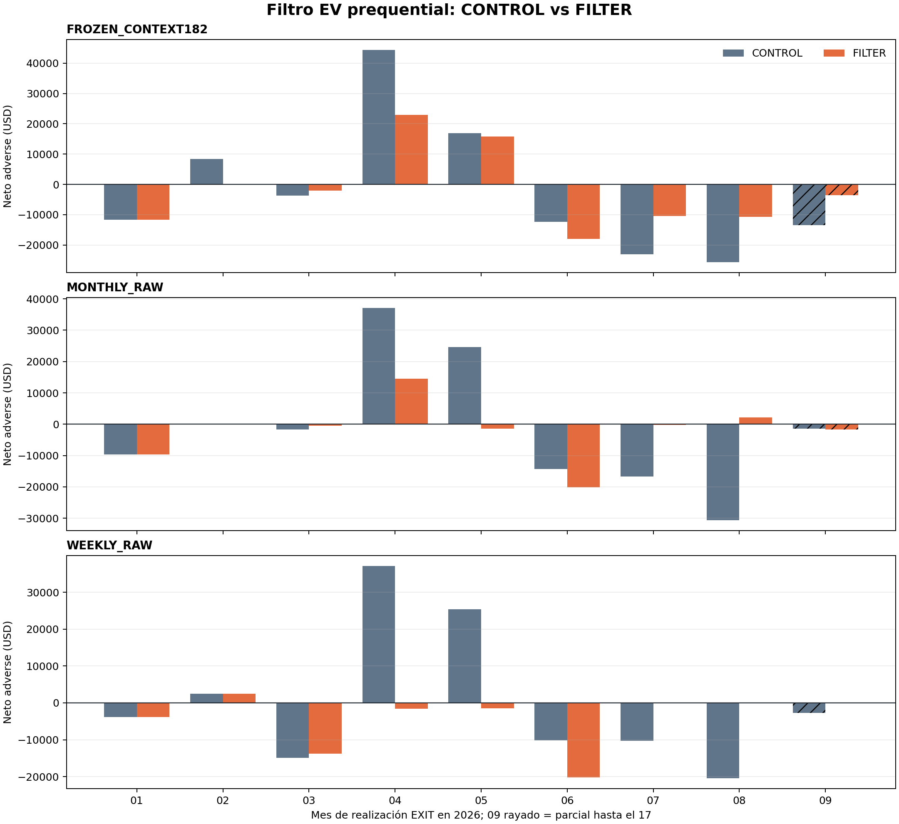

# Resultado descriptivo del filtro EV prequential

Este informe describe exclusivamente artefactos reconstruidos por la auditoría independiente. No reentrena modelos, no repite el replay y no selecciona una frecuencia ganadora. Todo 2026 permanece **SEEN_DEVELOPMENT**; `technical_ready=false` y `promotion_approved=false`.

## Autoridad

- Manifest productor: `4c166202bd3d20d16f88f7d6fbfef9f5fe42d099071be6b414d6786126e3ddec`.
- Auditoría independiente: `2012cc51c56b043b9c973dcb3c514a5d7a0fb158134a403963decc17d17713e2` (`PASS_INDEPENDENT_PREQUENTIAL_EV_FILTER_RECONSTRUCTION`).
- Exit auditor: `bc2fef5ec296d57dc078cf43d4a15399254b122a7df6088b003a38fe35cb4e0a` (`exit_code=0`).

## Economía adverse por política

| Política | Neto USD | 8/8 Ene-Ago | Meses positivos | Sep parcial | PF | DD realizado | ENTRY | EXIT |
|---|---:|:---:|---:|---:|---:|---:|---:|---:|
| FROZEN_CONTEXT182_CONTROL | -20,204.20 | No | 3/8 | -13,465.00 | 0.887 | 77,701.60 | 124 | 124 |
| FROZEN_CONTEXT182_FILTER | -17,691.20 | No | 2/8 | -3,611.00 | 0.766 | 44,154.00 | 45 | 45 |
| MONTHLY_RAW_CONTROL | -12,625.40 | No | 2/8 | -1,461.80 | 0.896 | 68,767.90 | 89 | 89 |
| MONTHLY_RAW_FILTER | -17,044.60 | No | 2/8 | -1,751.20 | 0.655 | 23,394.30 | 35 | 35 |
| WEEKLY_RAW_CONTROL | 2,693.80 | No | 3/8 | -2,757.20 | 1.026 | 46,860.80 | 83 | 83 |
| WEEKLY_RAW_FILTER | -38,255.80 | No | 1/8 | 0.00 | 0.168 | 38,255.80 | 26 | 26 |

El requisito necesario se aplica por cada FILTER: los ocho meses completos deben ser estrictamente positivos. Septiembre es parcial y no integra el criterio.

## Meses adverse: CONTROL frente a FILTER

### FROZEN_CONTEXT182

| Mes EXIT | CONTROL | FILTER | FILTER−CONTROL |
|---|---:|---:|---:|
| 202601 | -11,721.20 | -11,721.20 | 0.00 |
| 202602 | 8,324.80 | 0.00 | -8,324.80 |
| 202603 | -3,644.80 | -2,098.20 | 1,546.60 |
| 202604 | 44,379.20 | 22,972.00 | -21,407.20 |
| 202605 | 16,881.40 | 15,853.60 | -1,027.80 |
| 202606 | -12,348.40 | -17,998.20 | -5,649.80 |
| 202607 | -23,007.20 | -10,407.20 | 12,600.00 |
| 202608 | -25,603.00 | -10,681.00 | 14,922.00 |
| 202609 (parcial) | -13,465.00 | -3,611.00 | 9,854.00 |

### MONTHLY_RAW

| Mes EXIT | CONTROL | FILTER | FILTER−CONTROL |
|---|---:|---:|---:|
| 202601 | -9,641.40 | -9,641.40 | 0.00 |
| 202602 | 0.00 | 0.00 | 0.00 |
| 202603 | -1,630.20 | -525.00 | 1,105.20 |
| 202604 | 37,076.00 | 14,498.20 | -22,577.80 |
| 202605 | 24,568.80 | -1,456.60 | -26,025.40 |
| 202606 | -14,278.00 | -20,165.40 | -5,887.40 |
| 202607 | -16,639.80 | -186.60 | 16,453.20 |
| 202608 | -30,619.00 | 2,183.40 | 32,802.40 |
| 202609 (parcial) | -1,461.80 | -1,751.20 | -289.40 |

### WEEKLY_RAW

| Mes EXIT | CONTROL | FILTER | FILTER−CONTROL |
|---|---:|---:|---:|
| 202601 | -3,792.80 | -3,792.80 | 0.00 |
| 202602 | 2,517.00 | 2,517.00 | 0.00 |
| 202603 | -14,878.80 | -13,773.60 | 1,105.20 |
| 202604 | 37,076.00 | -1,584.40 | -38,660.40 |
| 202605 | 25,355.20 | -1,456.60 | -26,811.80 |
| 202606 | -10,124.40 | -20,165.40 | -10,041.00 |
| 202607 | -10,258.80 | 0.00 | 10,258.80 |
| 202608 | -20,442.40 | 0.00 | 20,442.40 |
| 202609 (parcial) | -2,757.20 | 0.00 | 2,757.20 |

## Activación y abstención

| Padre | Intenciones | Aceptadas | Podadas | Activación | n activación |
|---|---:|---:|---:|---|---:|
| FROZEN_CONTEXT182 | 223 | 68 | 155 | 20260130 | 20 |
| MONTHLY_RAW | 150 | 50 | 100 | 20260318 | 21 |
| WEEKLY_RAW | 142 | 39 | 103 | 20260319 | 21 |

El buffer 1.645 es heurístico: no es un intervalo de confianza ni un coste ejecutado. El filtro no cambia ranking o lado y sólo puede podar una intención raw positiva.

## Diagnóstico EV por contrato

Filas `TOTAL`; `N` es payoff potencial por contrato, incluso para intenciones no ejecutadas. Nunca se interpreta como PnL de cartera.

| Padre | Universo | Vista | n | LB | EV raw | EV gate | N | Bias raw | MAE raw | Bias gate | MAE gate |
|---|---|---|---:|---:|---:|---:|---:|---:|---:|---:|---:|
| FROZEN_CONTEXT182 | INTENTIONS | conservative_all | 223 | 15 | 153.73 | -74.92 | 27.09 | 126.64 | 1,080.96 | -102.01 | 1,014.14 |
| FROZEN_CONTEXT182 | INTENTIONS | without_lower_bounds | 208 | 0 | 162.20 | -77.11 | 74.92 | 87.28 | 1,110.43 | -152.03 | 1,044.61 |
| FROZEN_CONTEXT182 | ACCEPTED | conservative_all | 68 | 2 | 278.10 | 81.03 | -33.21 | 311.31 | 1,267.36 | 114.24 | 1,160.49 |
| FROZEN_CONTEXT182 | ACCEPTED | without_lower_bounds | 66 | 0 | 283.76 | 82.19 | -19.55 | 303.31 | 1,288.33 | 101.74 | 1,179.69 |
| FROZEN_CONTEXT182 | PRUNED | conservative_all | 155 | 13 | 99.16 | -143.33 | 53.55 | 45.62 | 999.19 | -196.88 | 949.94 |
| FROZEN_CONTEXT182 | PRUNED | without_lower_bounds | 142 | 0 | 105.70 | -151.15 | 118.83 | -13.13 | 1,027.74 | -269.98 | 981.82 |
| MONTHLY_RAW | INTENTIONS | conservative_all | 150 | 6 | 160.36 | -84.05 | 23.89 | 136.47 | 1,102.04 | -107.94 | 1,024.21 |
| MONTHLY_RAW | INTENTIONS | without_lower_bounds | 144 | 0 | 164.70 | -86.84 | 53.09 | 111.60 | 1,117.40 | -139.94 | 1,039.39 |
| MONTHLY_RAW | ACCEPTED | conservative_all | 50 | 2 | 215.36 | 98.65 | -155.70 | 371.05 | 678.16 | 254.35 | 598.74 |
| MONTHLY_RAW | ACCEPTED | without_lower_bounds | 48 | 0 | 219.70 | 99.20 | -133.01 | 352.71 | 672.61 | 232.21 | 590.96 |
| MONTHLY_RAW | PRUNED | conservative_all | 100 | 4 | 132.86 | -175.40 | 113.69 | 19.17 | 1,313.98 | -289.09 | 1,236.94 |
| MONTHLY_RAW | PRUNED | without_lower_bounds | 96 | 0 | 137.19 | -179.86 | 146.15 | -8.95 | 1,339.80 | -326.01 | 1,263.60 |
| WEEKLY_RAW | INTENTIONS | conservative_all | 142 | 6 | 163.28 | -104.83 | 34.36 | 128.92 | 1,140.07 | -139.19 | 1,067.49 |
| WEEKLY_RAW | INTENTIONS | without_lower_bounds | 136 | 0 | 168.49 | -107.50 | 66.04 | 102.45 | 1,158.20 | -173.54 | 1,086.37 |
| WEEKLY_RAW | ACCEPTED | conservative_all | 39 | 2 | 205.61 | 118.98 | -333.54 | 539.16 | 664.47 | 452.53 | 577.84 |
| WEEKLY_RAW | ACCEPTED | without_lower_bounds | 37 | 0 | 211.46 | 121.62 | -313.73 | 525.19 | 657.28 | 435.35 | 567.44 |
| WEEKLY_RAW | PRUNED | conservative_all | 103 | 4 | 147.25 | -189.58 | 173.66 | -26.41 | 1,320.15 | -363.24 | 1,252.89 |
| WEEKLY_RAW | PRUNED | without_lower_bounds | 99 | 0 | 152.43 | -193.14 | 207.97 | -55.55 | 1,345.42 | -401.11 | 1,280.32 |

## Lectura y límites

- `ENTRY` y `EXIT` se reconciliaron por separado; sólo `EXIT.net_usd` es PnL realizado.
- Una intención FILTER aceptada pertenece al top-1 raw positivo, pero sus fills no tienen por qué ser subconjunto de CONTROL porque los libros desarrollan estados distintos.
- `without_lower_bounds` es descriptivo y no genera decisiones alternativas.
- Ningún resultado de este informe autoriza selección, promoción o uso operativo.

